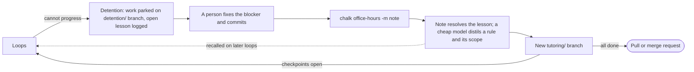

# Detention and office hours

When a run cannot make progress, it stops and waits for a person instead
of spending more. That stop is **detention**. The person fixes the
blocker and explains it in **office hours**; the explanation becomes a
**lesson** that later loops are given, in any repository on your machine
unless it holds only in its own.

## What sends a run to detention

Every detention prints the reason, then one `next:` line that says what to
do about it.

| Reason in the log | What happened | What `next:` says |
| :-- | :-- | :-- |
| `agent reported a blocker` | The agent answered `blocked`, for example for a missing credential or a contradiction in the spec. Retrying cannot fix that, so there is no retry. The agent also proposes a fix, with a probe for an environment problem: see [Blockers with a fix](#blockers-with-a-fix). | By the kind of fix: the packages a repository image needs (`image`), the settings to commit (`config`), the spec change (`spec`); otherwise, provide what the agent asked for: a credential, access or a decision |
| `pre-flight: a saved need fails: …` | Before the first loop, a need an earlier ticket saved in `.chalk/needs` failed: the environment lacks what that ticket needed. No loop ran, so nothing was spent. | Restore it in `CHALK_IMAGE` or `CHALK_SETUP_CMD`; check with `chalk needs` |
| `rubric failed (exit N)` | The rubric failed on `CHALK_MAX_RETRIES` + 1 loops in a row. | Fix the failure in `io/rubric.log`, or make the checkpoint smaller |
| `agent stopped early (CLASS: message)` | The loop's Claude Code call failed. CLASS says how, and the message is the CLI's own. A failure that would repeat (`tls`, `auth`, `cli_missing`, `usage_limit`) detains at once; the others (`network`, `rate_limit`, `overloaded`, `server`, `timeout`, `budget`, `max_turns`, `error`, `crash`) are retried first. | One line per class, for example: check `ANTHROPIC_API_KEY` or `CLAUDE_CODE_OAUTH_TOKEN` (`auth`); set `CHALK_EXTRA_CA_CERTS` (`tls`); raise `CHALK_AGENT_TIMEOUT` (`timeout`) or `CHALK_BUDGET_USD` (`budget`) |
| `rubric timed out after Ns (CHALK_RUBRIC_TIMEOUT)` | The rubric ran longer than `CHALK_RUBRIC_TIMEOUT` on every retry. A rubric killed with exit 137, usually for running out of memory, and one whose command was not found (126, 127) are named the same way. | Fix the failure in `io/rubric.log`, or make the checkpoint smaller |
| `the final review did not run (CLASS: message)` | The final review's call failed, and `CHALK_REVIEW_REQUIRED` is `true` (the default), so nothing is pushed without a review. | Fix what the line for CLASS says, then `chalk office-hours`; or set `CHALK_REVIEW_REQUIRED=false` to open requests that say the review did not run |
| `rubric passed but no checkpoint was ticked in the spec` | Retries ran out, and the last loop left the tests passing without finishing a checkpoint. | Tick it if it is done, or make it testable |
| `loop limit of N reached with M checkpoints open` | The run used `CHALK_MAX_LOOPS` loops. | Split the open checkpoints, or raise `CHALK_MAX_LOOPS` |
| `final review still finds problems after N fix round(s)` | The final review failed again after `CHALK_REVIEW_ROUNDS` fix rounds. The findings are printed. | Fix the findings, or raise `CHALK_REVIEW_ROUNDS` |
| `deja_vu: …` | Only with `CHALK_FP_RULES=on`: the loop fails like an open detention of another ticket. | Fix that ticket, which it names, first |
| `repeat: …` | Only with `CHALK_FP_RULES=on`: the same failing change as the loop before. | Fix the failure yourself; a retry would repeat it |
| `no_change: …` | Only with `CHALK_FP_RULES=on`: the agent changed nothing. | Make the checkpoint clearer, or do the step yourself |
| `the loop's commits could not be brought onto chalk/<TICKET>` | The branch changed in its worktree during the run (a commit or an edit there), so the loop's commits could not be fast-forwarded onto it. Git's reason is printed. | Merge the detention branch into `chalk/<TICKET>` yourself, and commit nothing to a branch while Chalk runs on it |

When the spec check's call fails in a way that would repeat, such as a
refused key, the run stops before the first loop with the same advice.

The verdicts are explained in [Verdicts](../operating/dashboard.md#verdicts).
Whatever the reason, when the last loop had three or more actions refused
by permission checks, `next:` says so and points to `chalk doctor` instead:
that is what a loop looks like when auto mode is unavailable for the model
(see [Permissions](../configuring/permissions.md#auto-mode-requirements)).

### Blockers with a fix

When the agent reports a blocker, it also proposes a fix, of one kind:
`image` (the sandbox lacks a tool or a system package), `config` (the
setup command or the rubric timeout is wrong), `spec`, `credential` or
`decision`. The detention shows it. A config fix may only name
`CHALK_SETUP_CMD` and `CHALK_RUBRIC_TIMEOUT`; any other setting it
proposes is dropped.

An `image` or `config` fix comes with a **probe**: one command that fails
now and must pass once the environment is fixed, such as `gcc --version`.
Chalk runs it right after parking the work, so what it writes never
reaches the detention branch, and says what it showed:

```text
[GO-5] the agent proposes a fix:
[GO-5]   kind: image
[GO-5]   why: go test -race: cgo: C compiler "gcc" not found
[GO-5]   probe: gcc --version
[GO-5]   image needs: apt-get install -y gcc libc6-dev
[GO-5] proof: the probe fails (exit 127), so the blocker is real; it must pass once you fix it
[GO-5] next: build a repository image FROM chalk-sandbox:local that adds: apt-get install -y gcc libc6-dev; set CHALK_IMAGE to it in .chalk/config and commit; the probe is checked again in a fresh sandbox at office hours
```

A probe that passes says the blocker may not be real; one that times out
after 30 seconds proves nothing. A missing tool's exit 127 counts as a
failure, since that is what most environment blockers are. Nothing acts
on the probe by itself: the run is detained either way.

### When a run stops without a detention

A run can also end because it was stopped (Ctrl-C, `kill`, a closed
terminal) or because Chalk itself failed. Either way, once a loop has
started, the agent's work since the last checkpoint is still committed and
parked on a detention branch, and the log says
`run stopped by a signal (exit 143)` or `Chalk stopped unexpectedly (exit N)`
with the same three lines to continue. When the sandbox had nothing beyond
your branch, the log says so instead.

If the work cannot be parked, for example because the container died, the
log says why. A container that still exists is kept as
`chalk-sandbox-…-kept-<timestamp>`, with the `docker cp` command that copies
the work out; a container that is gone is reported as gone.

The telemetry database is not needed to finish a run. If it goes away
mid-run (`chalk db down` refuses while runs are alive, unless you add
`--force`), Chalk warns once, keeps the error in `io/db.err`, and the run
goes on; the report card then misses what was not recorded.

## What detention does

- **Nothing is pushed.** The sandbox's work, including the failed attempt,
  is committed and parked on a local branch,
  `detention/<TICKET>-<timestamp>` (with `-2`, `-3` and so on when one
  ticket is detained twice in the same second). Your `chalk/<TICKET>` branch keeps only
  the loops that passed.
- **The failure is logged** in the `lessons` table as an open lesson:
  the reason, and the last 40 lines of the rubric's output or the
  blocker. When the rubric failed, the loop's fingerprint and first error
  are stored with it, so a later failure of the same kind can be matched.
- **The log says how to continue:**

```text
[PROJ-123] DETENTION: rubric failed (exit 1)
[PROJ-123] next: the rubric still fails after 2 retries; fix the failure in …/runs/PROJ-123/io/rubric.log, or make the checkpoint smaller
[PROJ-123] work parked on local branch detention/PROJ-123-1764000000. To unblock:
[PROJ-123]   cd '/home/sam/shop.worktrees/PROJ-123' && git switch 'detention/PROJ-123-1764000000'
[PROJ-123]   fix the blocker, commit, then: chalk office-hours -m "what was wrong"
```

## Office hours

```sh
git switch detention/PROJ-123-1764000000
# fix the blocker (missing mock, wrong assumption, unclear spec), commit
chalk office-hours -m "Payments client needs the sandbox base URL in tests"
```

`chalk office-hours` must be run from a `detention/…` branch. It:

1. **Checks your fix**, when the blocker came with a probe. It runs the
   probe in a fresh sandbox on the detention branch, on `CHALK_IMAGE`
   after `CHALK_SETUP_CMD`, as the resumed run will see the environment.
   If the probe still fails, it stops before recording anything: fix it,
   commit, and run office hours again, or add `--unproved` to resume
   anyway; when the probe is a saved need, the resumed run's pre-flight
   skips it, rather than detaining the run again. A probe that failed at detention and passes now **proves** the
   fix; any other result leaves the lesson unproved, and an unproved
   lesson is never recalled.
2. **Records your note** as the resolution of the open lesson, with your
   git email. This is the record of human intervention that the pull or
   merge request reports.
2. **Distils a lesson.** With `CHALK_DISTILL=true` (the default), a cheap
   model in a short-lived, read-only sandbox reads the failure, your note,
   the fix the agent proposed with what its probe showed, and your fix: the diff since the detention commit or, when you
   committed nothing, the fact that the fix was made outside the
   repository. Your note is the source of truth about what changed where.
   The model writes a rule and gives it a scope:
    - `general`: it holds in any repository, and is recalled anywhere.
    - `repo`: it depends on this repository, its sandbox image or its
      environment, and is recalled only here.
    - `none`: the evidence supports no rule, for example a one-off fix
      outside the repository. No lesson is recorded; your note is kept
      and recalled only here.

    The log says which: `lesson: …`, `lesson, recalled in this repository
    only: …` or `no lesson distilled: …`. If distillation fails, your note
    is still kept and used as the lesson.
3. **Saves the need**, when the fix is proved and about the environment
   (an `image` or `config` fix): its probe goes into `.chalk/needs`,
   committed, and every later run checks it before its first loop
   (pre-flight), so the same gap is never paid for twice. It reaches other
   tickets when this branch merges.
4. **Moves to a tutoring branch**, `tutoring/<TICKET>-<timestamp>`, so the
   detention branch stays as it was.
5. **Resumes the run** if the spec still has open checkpoints, or opens the
   pull or merge request if your fix finished it. `--detach` resumes in the
   background.

The [gates](../operating/merge-request-gates.md) treat `tutoring/*`
branches like `chalk/*` branches.

### Writing a useful note

The note is what later loops are told, so describe the cause and the
fix, not the symptom:

- Good: "Payments client needs the sandbox base URL in tests; set
  `PAYMENTS_URL` in `tests/setup.ts`."
- Less useful: "tests were failing".

When part or all of the fix is outside the repository, such as a rebuilt
sandbox image, a credential or a CI variable, say so in the note. The
diff shows only what you committed; without the note, a small commit that
came with an image change reads as if it were the whole fix. For example:
"PyYAML was missing from the sandbox image, which now installs
python3-yaml; requirements.txt also declares PyYAML."

Rules that should apply to every ticket from now on belong in the
textbook instead.

### Saved needs

`.chalk/needs` holds one need per line, written by office hours:

```text
gcc --version  # image GO-5 lesson=12
```

the probe, then, after the last `  # `, the kind of fix, the ticket and
its lesson. Every run checks each need after the setup command and before
the first loop. A need that fails detains the run as `pre-flight`, with
the need's probe on its lesson, so office hours checks your fix the same
way. One that times out is reported and the run goes on.

`chalk needs` checks every need in fresh sandboxes, twice: with the fix
(`CHALK_IMAGE` and `CHALK_SETUP_CMD`, as a run sees them), where it must
pass, and without it (the default image for an `image` need, no setup
command for a `config` one). A need that passes without its fix too is
**retired**: the environment no longer needs it, and its lesson stops
being recalled. `chalk needs --prune` removes retired needs from the file,
for you to commit. It exits non-zero when a need fails, so CI can run it.

## The failure lifecycle



1. Loops run until the run cannot progress, then it goes to detention:
   the work is parked on a `detention/` branch and an open lesson is
   logged with the failure.
2. A person switches to that branch, fixes the blocker and commits.
3. `chalk office-hours -m "…"` records the note as the lesson's
   resolution, and a cheap model distils it, with the fix, into a rule
   for any repository, a rule for this one, or no rule.
4. Chalk moves to a new `tutoring/` branch. If checkpoints are still open,
   the loops resume there; if not, the pull or merge request opens.
5. From then on, resolved lessons are [recalled](../configuring/lesson-memory.md)
   into the prompts of later loops whose failures look the same.

## Giving up on a ticket

A detention branch stays until you delete it. `chalk cleanup` keeps
branches that are neither merged nor pushed; `chalk cleanup --all` deletes
them, detention work included.
